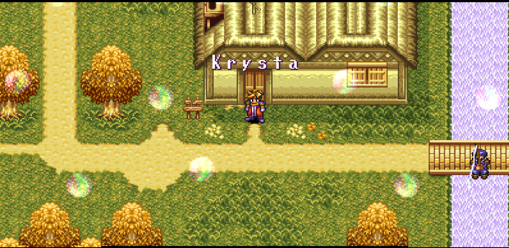
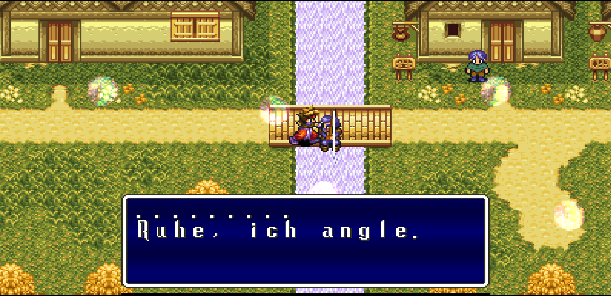
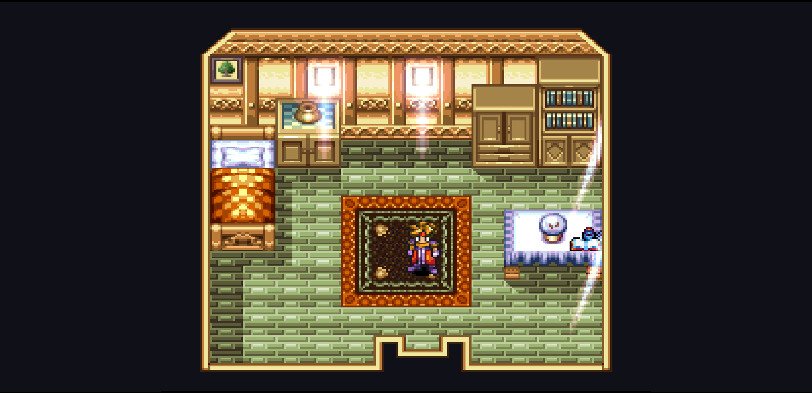

# Terranigma Recomp

Static recompilation of **Terranigma** (German release, Rev 1) built on
[snesrecomp](https://github.com/RetroPortingToolKit/snesrecomp) and
[recomp-ui](https://github.com/RetroPortingToolKit/recomp-ui), with a native
**16:9 widescreen** mod.

Action RPG by Quintet (Super Nintendo, 1995 in Japan, 1996 in Europe), recompiled to run natively with modern enhancements.

| Title | Terranigma |
|---|---|
| Developer | Quintet |
| Publisher (PAL) | Nintendo |
| Players | 1 |
| Region | Germany (DEU), Rev 1, PAL |
| Mapping | HiROM, no coprocessor |

> **You must legally own a copy of the game. No ROM is included in this
> repository or in any release, and none must ever be uploaded.** The
> recompiled C code is generated locally from your own copy and is never
> committed.

## Screenshots

16:9 widescreen (398x224), running natively:







## The ROM: what you need and where it is read from

You need exactly one file, dumped from your own cartridge:

| | |
|---|---|
| File | `Terranigma (Germany) (Rev 1).sfc` |
| Size | 4,194,304 bytes (headerless) |
| CRC32 | `6fb8a4df` |
| SHA-256 | `613cd1a31eaded18648168bd7453a57830ca9a6f3c10de5154625436fbd49556` |

The ROM can live **anywhere on your drive, outside this folder** (recommended).
Nothing in the repository contains it, and `.gitignore` blocks `*.sfc`,
`*.smc` and `*.srm` as well as the local settings file `rom.cfg`, so it cannot
be committed by accident. Where it is looked up, in this order:

1. The launcher (`TerranigmaSNESRecomp.exe` without arguments) opens a file
   picker with a verification badge. Your choice is cached in **`rom.cfg`**
   beside the executable (a machine-specific absolute path; ignored by git).
2. The command line: `TerranigmaSNESRecomp "path/to/Terranigma (Germany) (Rev 1).sfc"`.
3. For `tools/regen.sh`: `--rom <path>`, then the environment variable
   `SNESRECOMP_ROM`, then the file name at the repository root, then the path
   stored in `rom.cfg`.

Before anything runs, the ROM is checked against the digests above (read from
`rom_identity.txt`). A different revision or a bad dump is refused.

## Download

No release has been published yet. Releases will contain a *setup pack*: the
launcher takes your own ROM, generates the game code on your machine, builds it
and starts it. No game data is part of the download.

## What is built in

**Status: playable, work in progress.** The game boots and is played in the
debug build. The widescreen mod (`terranigma.widescreen`) is presentation-only:
the game simulation stays 256 pixels wide, only the picture is widened to
398x224 (16:9). Savegames and save states are not affected by it.

### 16:9 widescreen (feature `widescreen`)

- **Wide world from the game's own map data.** The game only keeps a 32x32 tile
  ring in VRAM, so the side margins would show a wrapped copy of the screen.
  The mod reads the map directly from WRAM (16x16 metatile map and metatile
  definitions) and computes every margin tile itself. A per-frame self-test
  compares this against the real VRAM; if a scene does not match (menus, title,
  static screens) it falls back to a clean edge clamp automatically.
- **Edges hidden under the game's 8 px border.** The outermost native columns
  are taken from the map as well, so no stale column streaks appear at the old
  4:3 edge.
- **The game's dark 8 px border (BG3) is hidden.** Terranigma covers the streaming column at the screen edge with a dark frame on BG3. In widescreen it would show as black strips at the old 4:3 edge, so the mod clears its two border columns while the picture is drawn. Text boxes are not affected. The game state is untouched.
- **Map edge:** beyond the map the margin shows the game's background colour
  (outdoors) or the dark edge column (rooms), instead of repeating the picture.
- **Rooms:** rooms are 256 px blocks side by side in one map. Everything
  outside the current room is hidden, so neighbouring rooms and their lights
  never show.
- **NPCs, enemies and objects outside 4:3.** The game culls objects at the 4:3
  edge in two places (object list and OAM emitter). Both tests are widened
  through interpreter hooks, left and right, so characters walk in smoothly.
  Disabled in rooms.
- **Menus** use a clamp, which was checked in the file menu.
- **Switchable:** the feature can be turned off in the launcher's Mods page;
  the side-margin policy is the option `edge_policy` (default `natural`, which
  is the world-aware mode; `clamp`, `mirror`, `repeat` for comparison).

### PAL region fix

The German release is a PAL game and refuses to start on a console that does
not report PAL ("This game pak is not designed for your Super Famicom or Super
NES"). A small framework patch makes `$213F` bit 4 report PAL. Timing stays
NTSC 60 Hz (the framework has no PAL timing mode), so the game runs about 20 %
faster than on a real PAL console.

### Framework patches

The two changes to snesrecomp live in `patches/snesrecomp-terranigma.patch`
and are applied automatically at CMake configure time (or by
`bash tools/apply_framework_patches.sh`):

- `g_snes_ppu_report_pal`: the PAL flag above.
- `ppu_read`: reading a write-only PPU register returns open bus instead of
  asserting in Debug builds (Terranigma does this).

### Not yet tested / known issues

World map, intro and title, Mode 7 scenes, fades, HUD in widescreen, enemy
spawning at the new edge (objects are visible, spawn distance is unchanged),
dialogs at the margins. Release builds of the mod are not tested; development
used the Debug build.

## Build

Requirements: a C compiler toolchain, CMake, Git, Python 3 and (for the
launcher) Rust. On Windows: Visual Studio with the C++ workload.

```sh
git clone --recurse-submodules https://github.com/Benexdrake/Terranigma-Recomp.git
cd Terranigma-Recomp
bash tools/regen.sh --rom "/path/to/Terranigma (Germany) (Rev 1).sfc"
cmake -S . -B build
cmake --build build --config Release
```

`tools/regen.sh` verifies the ROM, generates `src/gen/*.c` and re-syncs
`recomp/funcs.h`. Re-run it whenever you change anything under `recomp/`.
Never edit `src/gen/` by hand.

The build applies the framework patch itself. If the framework revision does
not match `framework_pins.txt`, the patch can fail to apply and CMake says so.

## Run

```sh
./build/TerranigmaSNESRecomp                      # launcher picks the ROM
./build/TerranigmaSNESRecomp "path/to/Terranigma (Germany) (Rev 1).sfc"
```

### Debugging

Build with `-DSNESRECOMP_ENABLE_TRACE=ON` to get the TCP debug server on port
4377 (see `snesrecomp/docs/DEBUG_ROUTES.md`). `ws_shadow_stats` shows whether
the margin provider answers (a rising `RawFallback` counter means it does not).
`TERRA_WS=natural|clamp|mirror|repeat` overrides the margin policy for tests.

## Layout

| Path | What lives there |
|---|---|
| `recomp/` | Analysis input: `bank*.cfg`, `symbols.toml`, generated `funcs.h` |
| `rom_identity.txt` | ROM digests, read by the build, `tools/regen.sh` and CI |
| `src/` | Host code: `main.c`, `game_rtl.c`, `terranigma_widescreen.c` (the widescreen mod) |
| `src/gen/` | Generated C. Never committed, regenerate locally |
| `mods/preloaded/packages/terranigma.widescreen/` | Mod package (manifest, feature, options) |
| `patches/` | Local patches for the snesrecomp submodule |
| `snesrecomp/` | Framework submodule |
| `recomp-ui/` | Launcher submodule |
| `tools/` | `regen.sh` (ROM to C), `apply_framework_patches.sh` |
| `scripts/` | `package_release.sh`, the player-facing zip |
| `framework_pins.txt` | Exact framework commits this project was built against |

## Multiplayer

Single player.

## License

This project's own source is under the license in `LICENSE`. The framework
carries its own terms: see `snesrecomp/LICENSE` and
`snesrecomp/THIRD_PARTY_ATTRIBUTION.md`. Neither covers the game data, which is
not distributed here. Terranigma is a trademark of its respective owners; this
is an unofficial fan project.
